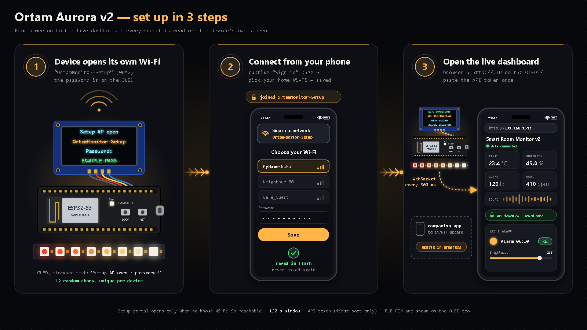
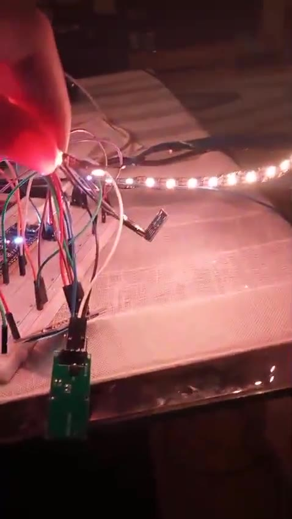
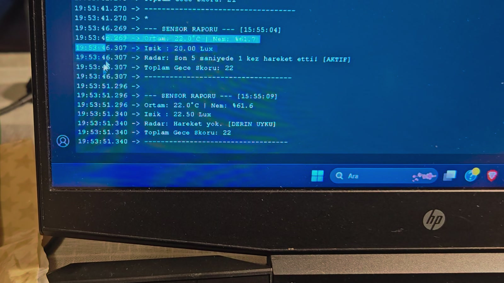
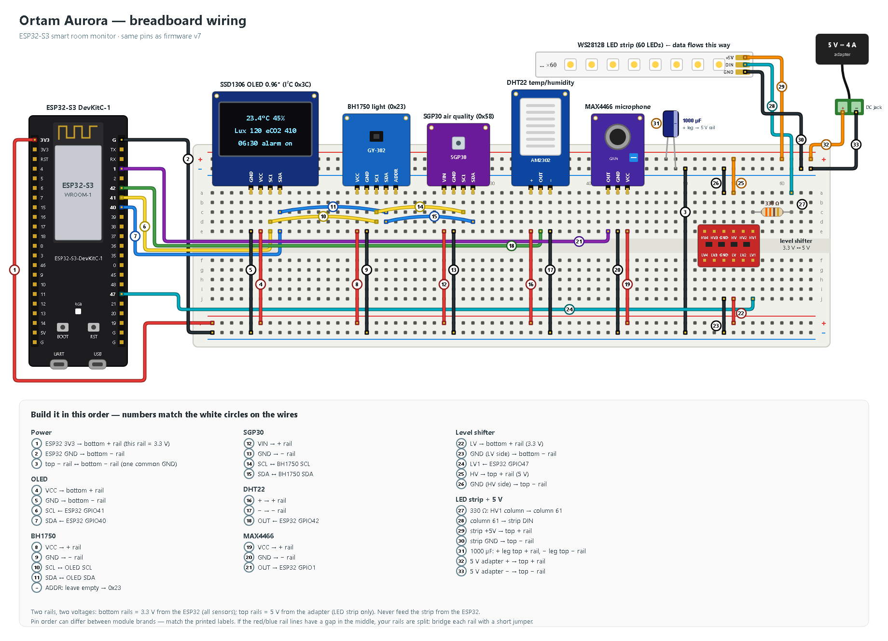

# Ortam Aurora

**An ESP32-S3 room monitor that wakes you with a simulated sunrise — four sensor modules (DHT22, BH1750, SGP30, MAX4466) + OLED, a 60-LED strip, a live web dashboard and BLE, in one firmware file.**

Built by **Alp Serkan Merkit** (mechanical engineer) with AI coding agents.

> **v2 — Hardened.** Wi-Fi setup, web API, WebSocket and Bluetooth all need a per-device secret now. Known limits (plain HTTP on the LAN, setup-portal OTA page, no Secure Boot) are listed in [SECURITY](SECURITY.md). See also [CHANGELOG](CHANGELOG.md).

---

## Setup in 3 steps



1. **The device opens its own Wi-Fi.** It is called `OrtamMonitor-Setup`; its password is shown on the OLED every time this setup network opens (on first setup, and on any boot when no saved Wi-Fi is reachable).
2. **Connect with your phone.** A "sign in" page opens by itself — pick your home Wi-Fi. It is saved and never asked again.
3. **Open the live dashboard.** The device shows its IP on the OLED. Open `http://<device-ip>/` in a browser and paste the API token once; live data then updates every 500 ms. *(Companion phone app — a separate project, not in this repository — update for token/PIN in progress; see Status.)*

## Status

| Item | State |
|---|---|
| v1 field build ([`firmware/legacy/v1_field/`](firmware/legacy/v1_field/)) | ✓ Field-tested on hardware |
| v2 secure build ([`firmware/ortam_aurora/`](firmware/ortam_aurora/)) | ✓ Flashed on hardware (owner-reported, 2026-10-06) |
| Companion phone app — update for API token / BLE PIN | Pending |


## What it does

- **Watches the room:** temperature and humidity (DHT22), ambient light (BH1750), air quality as eCO2/TVOC (SGP30), and sound level (MAX4466 microphone).
- **Wakes you gently:** it fetches today's sunrise time from `api.sunrise-sunset.org`, then starts a 30-minute red → orange → warm-white fade on a WS2812B strip, timed to begin 30 minutes before sunrise. If the room is already bright (≥ 50 lx), the alarm is skipped.
- **Shows everything live:** a 128×64 OLED on the device, a web dashboard served by the ESP32 itself (WebSocket updates every 500 ms), a REST API, and a BLE GATT service for a phone app.
- **Survives the real world:** Wi-Fi credentials via a captive setup portal (WiFiManager), settings and SGP30 calibration baseline kept in flash (NVS), automatic Wi-Fi reconnect with BLE as fallback, and a 30 s task watchdog.

## Demo


| | |
|---|---|
| Bench build — sensors + sunrise strip | [video](docs/media/ortam_demo.mp4) ·  |
| Live serial log — *earlier build (radar + night score)* | [video](docs/media/ortam_serial.mp4) ·  |
| Breadboard wiring (33 numbered steps) |  |

## Features (as implemented in `firmware/ortam_aurora/ortam_aurora.ino`)

| Area | Details |
|---|---|
| Sensors | DHT22 (GPIO42), BH1750 + SGP30 + OLED on one I²C bus (SDA 40 / SCL 41), MAX4466 on ADC GPIO1 with a 3 s auto-calibration at boot |
| Air quality | SGP30 humidity compensation from DHT22 readings; IAQ baseline saved to NVS hourly and restored at boot |
| Light | 60 × WS2812B on GPIO47 via level shifter; FastLED power cap 5 V / 4000 mA; brightness capped at 160/255 |
| Sunrise alarm | Sunrise time from `api.sunrise-sunset.org` (HTTPS), refreshed after midnight; 30-min colour/brightness ramp; alarm on/off persisted in NVS |
| Web | Single-page dashboard at `/` (sensor cards, colour picker, brightness slider, sunrise / lux-demo / off / alarm buttons) |
| API | REST under `/api/*`, WebSocket at `/ws` (JSON push every 500 ms) |
| BLE | NimBLE GATT service with 4 characteristics: sensor JSON (read/notify), status JSON (read/notify), LED control (write), alarm control (write) — all behind passkey pairing |
| Robustness | WiFiManager portal (120 s), reconnect every 30 s, BLE keeps working without Wi-Fi, task watchdog 30 s, error line on the OLED |

### Commands (WebSocket text, BLE write, or via REST)

`led_on` (start sunrise animation) · `led_off` · `lux_demo` (8 s bright boost) · `alarm_toggle` · `led_set:r,g,b,brightness` · `led_color:r,g,b` · `led_brightness:n`

## Hardware

| Part | Role | Connection |
|---|---|---|
| ESP32-S3 development board | MCU, Wi-Fi + BLE | — |
| SSD1306 OLED 0.96″ 128×64 (I²C 0x3C) | Local display | SDA GPIO40, SCL GPIO41, 3.3 V |
| BH1750 (I²C 0x23) | Ambient light | shares I²C bus, 3.3 V |
| SGP30 (I²C 0x58) | eCO2 / TVOC | shares I²C bus, 3.3 V |
| DHT22 | Temperature / humidity | DATA GPIO42, 3.3 V |
| MAX4466 | Sound level | OUT GPIO1 (ADC), 3.3 V |
| Logic level shifter (3.3 V → 5 V) | Data line for the LED strip | LV1 ← GPIO47, HV1 → 330 Ω → DIN |
| WS2812B strip, 60 LEDs | Sunrise light | external 5 V supply |
| 330 Ω resistor | Series resistor on DIN | between shifter HV1 and strip DIN |
| 1000 µF capacitor | Strip inrush buffer | across 5 V / GND near strip input |
| 5 V power adapter | Powers the strip | strip +5V / GND, common ground with ESP32 |
| Breadboard + jumper wires | — | — |

**Ground rule:** all grounds (3.3 V side, 5 V side, adapter) must be common.

## Wiring


Vector version: [`docs/wiring.svg`](docs/wiring.svg) · generated by [`docs/draw_wiring.py`](docs/draw_wiring.py).

The diagram has 33 numbered steps. Build in this order:

| Steps | Block | What to connect |
|---|---|---|
| 1–3 | Power | ESP32 3V3 → bottom + rail (3.3 V), ESP32 GND → bottom − rail, bridge top − and bottom − rails (one common GND) |
| 4–7 | OLED | VCC/GND to 3.3 V rails, SCL ← GPIO41, SDA ← GPIO40 |
| 8–11 | BH1750 | VCC/GND to rails, SCL/SDA chained to OLED; ADDR left open → 0x23 |
| 12–15 | SGP30 | VIN/GND to rails, SCL/SDA chained to BH1750 |
| 16–18 | DHT22 | +/− to rails, OUT ← GPIO42 |
| 19–21 | MAX4466 | VCC/GND to rails, OUT → GPIO1 |
| 22–26 | Level shifter | LV → 3.3 V, LV GND, LV1 ← GPIO47, HV → 5 V rail (top), HV GND |
| 27–33 | LED strip + 5 V | 330 Ω from HV1 to strip DIN, strip +5V/GND to top rails, 1000 µF across top rails, 5 V adapter +/− to top rails |

Module pin order differs between brands — follow the labels printed on your boards.

## Build and flash

1. **Arduino IDE** with the ESP32 board package **2.0.17** (Espressif). Board: **ESP32-S3 Dev Module**.
2. Install the libraries (versions the firmware was developed with):

   | Library | Version |
   |---|---|
   | ESP Async WebServer (ESP32Async) | 3.10.3 |
   | Async TCP (ESP32Async) | 3.4.10 |
   | FastLED | 3.6.0 (3.7.0 if 3.6.0 fails) |
   | NimBLE-Arduino (h2zero) | 1.4.3 |
   | WiFiManager (tzapu) | 2.0.x |
   | Adafruit GFX, Adafruit SSD1306, DHT sensor library + Adafruit Unified Sensor, BH1750 (Christopher Laws), Adafruit SGP30 | latest |

3. Open `firmware/ortam_aurora/ortam_aurora.ino` and set your location in the `LOCATION` block (`LATITUDE` = latitude, `LONGITUDE` = longitude, `UTC_OFFSET_HOURS`). The default is a city-level location, **İzmir city centre** (38.4237, 27.1428, UTC+3) — set your own city. These coordinates are sent to `api.sunrise-sunset.org`; the UTC offset is fixed (no daylight-saving switch).
4. Upload, open the Serial Monitor at **115200 baud**, and **write down the two secrets** printed on first boot (also shown on the OLED for 15 s): setup-AP password and API token. They are not printed to Serial again, and the API token is not shown again; the AP password reappears on the OLED whenever the setup portal opens. (BLE uses a fresh PIN per pairing, shown on the OLED at that moment.)
5. Join the Wi-Fi network `OrtamMonitor-Setup` with the AP password and pick your home Wi-Fi.
6. Open `http://<device-ip>/` (the IP is shown on the OLED) and paste the API token when the page asks.

Lost the secrets? Erase the flash (e.g. *Tools → Erase All Flash Before Sketch Upload*) and upload again; new ones are generated.

> Note: the firmware targets ESP32 Arduino core **2.0.17** (ESP-IDF 4.4 APIs such as `esp_task_wdt_init(timeout, panic)`); core 3.x is not supported without changes.

## Security model

The v1 field build trusted everyone on the same Wi-Fi and in BLE range. v2 closes the obvious holes (full threat model: [SECURITY.md](SECURITY.md)):

| Surface | v1 | v2 |
|---|---|---|
| Wi-Fi setup portal | Open access point | WPA2 with a per-device random 12-character password generated on first boot (NVS) |
| HTTP API | No auth; state changes via GET (triggerable from any web page) | Every `/api/*` call needs `Authorization: Bearer <token>`; `/api/led/on`, `/api/led/off`, `/api/led/set`, `/api/alarm/toggle` are **POST-only** |
| WebSocket `/ws` | Any client could send commands and receive sensor data | First message must be the token within 5 s, otherwise the socket is closed; sensor data is pushed only to authorised clients |
| BLE | Unauthenticated reads and writes from anyone in range | Bonding + MITM protection + LE Secure Connections, requested as soon as a phone connects. All four characteristics need an encrypted, authenticated link. A **new random 6-digit PIN is generated for every pairing** and shown on the OLED (no static passkey). Links that fail or skip authentication are dropped (within about 30 s), and no notifications are sent while an unauthenticated link is open |
| Secret storage | — | If the secrets cannot be written to NVS, the device fails closed: API/WebSocket reject everyone and the setup portal does not open |

Example:

```bash
curl -H "Authorization: Bearer <token>" http://<device-ip>/api/sensors
curl -X POST -H "Authorization: Bearer <token>" -d "r=255&g=120&b=40&brightness=100" http://<device-ip>/api/led/set
```

**Trust assumptions and known limits** — stated plainly rather than hidden:

- **Trusted local network.** The token travels over plain HTTP/WebSocket (no TLS), so anyone who can sniff the LAN can read it. Do not expose the device to the internet.
- **Setup portal OTA page.** While the WiFiManager portal is open (up to 120 s, only when no known Wi-Fi is reachable), the library's `/update` firmware-upload page is reachable to anyone who has joined the WPA2-protected setup AP — a physical-proximity risk.
- **Physical access = full access.** Secrets sit unencrypted in NVS and appear on Serial/OLED at first boot; the AP password is also shown on the OLED every time the setup portal opens; no Secure Boot or flash encryption.
- The `Bearer` prefix in the `Authorization` header is **case-sensitive** (`Bearer <token>`, not `bearer <token>`).
- The sunrise API call uses TLS **without certificate validation** (`setInsecure()`).
- The dashboard page `/` itself is public; it holds no data and asks for the token in the browser (stored in `localStorage`).
- A companion phone app (not in this repository) must pair with the per-pairing PIN and send the token.

## Credits

Built by **Alp Serkan Merkit** with AI coding agents. Libraries: Espressif Arduino-ESP32, ESP32Async (AsyncTCP, ESPAsyncWebServer), FastLED, NimBLE-Arduino, WiFiManager, Adafruit (GFX, SSD1306, SGP30, DHT, Unified Sensor), BH1750. Sunrise data: [sunrise-sunset.org](https://sunrise-sunset.org/api).

## License

[MIT](LICENSE) © 2026 Alp Serkan Merkit
