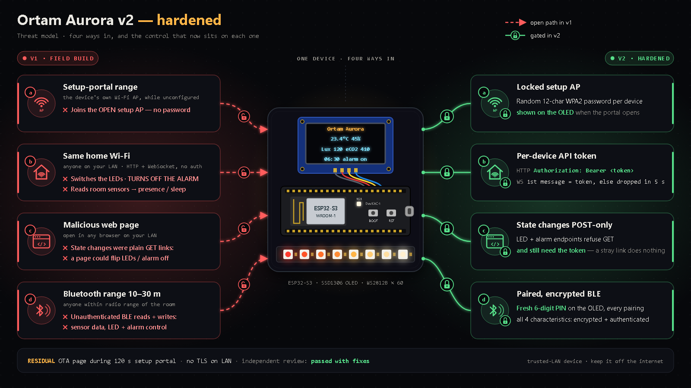

# Security

**Supported version:** v2.0 ([`firmware/ortam_aurora/`](firmware/ortam_aurora/)). The v1 field build in [`firmware/legacy/`](firmware/legacy/) is kept for reference only and has no security controls — do not use it on a shared network.

**Status:** independent review passed (2 rounds); v2 flashed and running on the device (owner-reported, 2026-10-06).

**Independent review: passed (2 rounds); two minor notes applied.** Round 1 findings were fixed in v2.0; round 2 verified the fixes, and its two non-blocking notes (BLE advertising starts only after setup; notifications re-check the live connection list) are applied.

## Threat model

| Attacker position | v1 exposure | v2 mitigation |
|---|---|---|
| **Setup-portal range** (near the house while the setup network is up) | Setup network was open: anyone could join, point the device at their own Wi-Fi, or upload firmware through the portal's update page | WPA2 setup network with a per-device random 12-character password. The password is printed to Serial once (first boot) and shown on the OLED every time the setup portal opens (first setup, or any boot when no saved Wi-Fi is reachable). The portal does not open at all if the password could not be saved |
| **Same Wi-Fi** (guest, compromised laptop or smart device) | Full read and control: sensor data (shows whether someone is home or asleep), LED and alarm commands over HTTP and WebSocket | Every `/api/*` call needs a Bearer token; WebSocket clients must send the token within 5 s or are dropped; data is pushed only to authorised clients |
| **Malicious web page** (opened in a browser on your network) | A link or image tag could fire the GET endpoints and switch the light or alarm; the page could also open the WebSocket and send commands | Changes are POST-only and need the `Authorization` header, which a foreign page cannot add (no CORS headers are sent); the WebSocket needs the token |
| **BLE range** (≈ 10–30 m, e.g. neighbours, street) | Anyone could read sensor and status data and write LED/alarm commands without pairing | LE Secure Connections + MITM + bonding; all four characteristics need an encrypted, authenticated link; a new random 6-digit PIN appears on the OLED for each pairing; unpaired links are dropped within about 30 s and get no notifications |

## Residual risks (v2)

- **OTA page in the setup portal.** While the portal is open (up to 120 s, only when no known Wi-Fi is reachable), WiFiManager's `/update` firmware-upload page is open to anyone who has joined the setup network — i.e. anyone who knows the AP password.
- **No TLS on the LAN.** The token travels over plain HTTP/WebSocket; anyone who can sniff your Wi-Fi traffic can read it. Do not expose the device to the internet.
- **BLE notification subscription (CCCD).** A phone can subscribe to notifications before pairing (NimBLE does not protect this descriptor). Mitigated: no notifications are sent while any unauthenticated link is open, and such links are dropped.
- **No Secure Boot or flash encryption.** Anyone with physical access can read the secrets from flash or re-flash the board, and can read the AP password off the OLED whenever the setup portal is open.
- The sunrise-time request uses HTTPS without certificate validation (`setInsecure()`); a network attacker could fake the sunrise time.

## Reporting a vulnerability

Open an issue on this repository's GitHub **Issues** page. Please describe the affected area but leave out working exploit details in the public issue; we will reply there to arrange the details.
